# 24 V → 2.5 V / 3.3 V Synchronous Buck Converters with SCR Crowbar Protection

**Eric Zhang** · Power stage of the PN (Power & Network) Controller board · Altium Designer · 6-layer PCB

Two 3 A point-of-load regulators built around the **TI LM60440** (36 V, 4 A, 1 MHz synchronous buck). They step a 24 V bus down to the rails that power an Ethernet switch / PoE / SFP subsystem. Each rail has a replaceable fuse, a Zener-triggered SCR crowbar, and a fuse-status LED. Every component value below is derived from, and cross-referenced to, the [LM604x0 datasheet (SNVSBN5A)](https://www.ti.com/lit/ds/symlink/lm60430.pdf).

> **Status:** schematic and layout complete; board not yet fabricated. No bench data or simulation yet. The [bring-up test plan](docs/bringup_test_plan.md) defines what will be measured and the pass criteria.

<p align="center">
  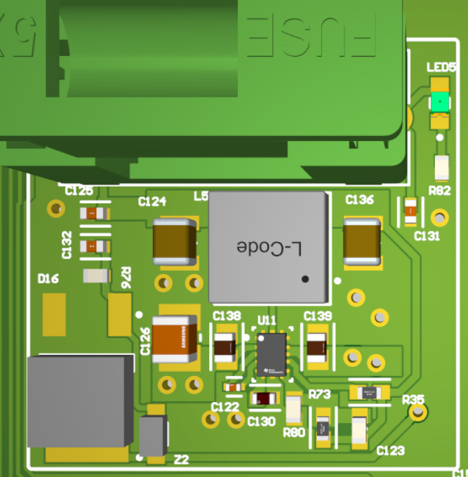
  &nbsp;&nbsp;
  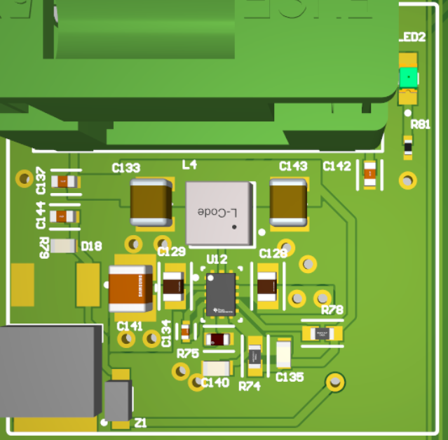
</p>

---

## Highlights

- **Datasheet-driven design.** Feedback divider, inductor, output/input capacitors, feed-forward cap, bootstrap/VCC caps and PG pull-up are each sized with the TI design equations and cited by section and equation number ([full derivations](docs/design_calculations.md)).
- **Worst-case analysis, not just nominal.** Output tolerance from $`V_{REF}`$ ±1.5 % and 1 % resistors, minimum on-time headroom across the 1 MHz ±15 % oscillator spread, inductor peak current at −20 % inductance, and crowbar trip windows across Zener tolerance and SCR gate-voltage spread.
- **Reproducible numbers.** Every value on this page comes from [`calc/buck_calcs.py`](calc/buck_calcs.py), so changing a component and re-running updates the whole analysis.
- **Self-review.** The analysis found that the 3.3 V crowbar trips too high (≈5.4–6.7 V) to protect a 4 V-abs-max load. That finding and the other Rev 2 improvements are documented in the [design review](#design-review--rev-2) below.

## Specifications

| Parameter | 2.5 V rail | 3.3 V rail |
|---|---|---|
| Regulator | LM60440DRPKR (U12) | LM60440DRPKR (U11) |
| Input | 24 V nominal (3.8–36 V device range) | 24 V nominal |
| Output (nominal / worst case) | 2.504 V / 2.44–2.57 V | 3.315 V / 3.22–3.41 V |
| Design load current | 3 A (device limit ≥ 4.35 A) | 3 A (device limit ≥ 4.35 A) |
| Switching frequency | 1 MHz fixed ("D" option) | 1 MHz fixed |
| Inductor | 3.3 µH, WE-XHMI 4030 (74439324033) | 4.7 µH, WE-XHMI 7030 (74439384047) |
| Inductor ripple $`\Delta I_L`$ | 0.68 A (K = 0.23) | 0.61 A (K = 0.20) |
| Output capacitance | 2 × 100 µF 1210 + 100 nF | 2 × 100 µF 1210 + 100 nF |
| Calculated output ripple | ≈ 1.1 mV p-p | ≈ 1.0 mV p-p |
| Protection | 4 A fuse (5×20 mm) + MMSZ3V3 / MCR706A crowbar | 4 A fuse (5×20 mm) + SZMMSZ5V1 / MCR706A crowbar |
| Downstream loads | MIC2774N supervisor, TPS7A8300A LDO | 2× KSZ9897S, 2× KSZ8895RQ, TPS23861 PoE PSE, SFP+ cage (Samtec SFPK) |

## System Context

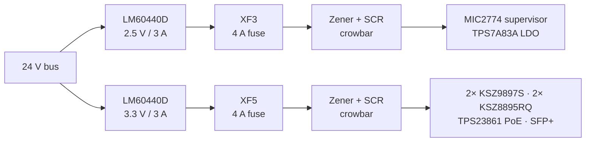

## Design Decisions

Short version below; the [calculations document](docs/design_calculations.md) has every equation and datasheet reference.

| Decision | Choice | Why |
|---|---|---|
| Regulator | LM60440 (4 A) for a 3 A load | Integrated FETs and internal compensation make for a small footprint. Using the 4 A part leaves ≥ 45 % current-limit headroom (Eq. 1: $`I_{OUT,max} \ge 4.35`$ A worst case). |
| Switching frequency | 1 MHz ("D" variant) | Allows a smaller inductor and output capacitance than 400 kHz. The minimum on-time check (Eq. 2) shows the 2.5 V rail stays in fixed-frequency PWM up to ≈ 27 V input in the worst case, and the 3.3 V rail up to ≈ 36 V. |
| Feedback | $`R_{FBT}`$ = 100 kΩ (TI recommended), $`R_{FBB}`$ = 66.5 kΩ / 43.2 kΩ | Eq. 3 with nearest E96 values gives 2.504 V and 3.315 V (+0.15 % / +0.45 % from target). |
| Inductors | 3.3 µH / 4.7 µH WE-XHMI | Ripple of 23 % / 20 % of the 3 A load, inside TI's 20–40 % window and above the 10 %-of-4 A floor that current-mode control needs. Peak current (3.5 A worst case) stays below $`I_{SAT,10\%}`$ (3.9 A / 4.9 A), and $`I_{SAT,30\%}`$ (8.2 A / 11 A) exceeds the 6 A high-side current limit, so the inductor won't saturate even in a short. |
| Output caps | 2 × 100 µF 1210 MLCC | Eq. 5 requires 117 µF (2.5 V) and 94 µF (3.3 V) *effective* for a 0→3 A step held within ±5 %. ESR limits (≥ 37 mΩ) are easily met by ceramics. |
| Feed-forward cap | 10 pF / 15 pF | Eq. 8 upper bound is 33–66 pF (2.5 V) and 50–100 pF (3.3 V). TI recommends starting below the bound and only increasing it if a Bode plot shows a phase-margin benefit. |
| Input caps | 10 µF 50 V X7R 1210 + 2 × 220 nF 50 V per rail | TI requires ≥ 10 µF ceramic and a small 220 nF HF bypass at each VIN/PGND pair, rated ≥ 2 × VIN. RMS ripple current ≈ $`I_{OUT}/2`$ = 1.5 A (Eq. 7). |
| CBOOT / CVCC / PG | 100 nF / 1 µF / 100 kΩ to VOUT | These are the values the datasheet specifies (§9.2.2.7, §9.2.2.8, §8.3.1). |
| Fuse | Littelfuse 217-series 4 A fast-acting, 5×20 mm | 3 A is 75 % of rating. 48 mV drop (16 mΩ). Opens in ≤ 20 ms at 10 × rated current. The fuse sits *outside* the feedback loop on purpose: if FB sensed after the fuse, a blown fuse would read as 0 V and drive the regulator to maximum duty cycle. |

## Overvoltage Crowbar

If a regulator fails (for example, a high-side FET short), the output can rise toward 24 V and destroy every downstream IC. Each rail therefore has a latching crowbar downstream of its fuse:

1. **Detect.** A Zener from the rail to the SCR gate stays off in normal operation.
2. **Filter.** $`R_{GK}`$ = 100 Ω and $`C_{GK}`$ = 100 nF set the trigger current and give a 10 µs filter against switching spikes and the SCR's dv/dt sensitivity.
3. **Trigger and latch.** When $`V_{RAIL} > V_Z + V_{GT}`$, the MCR706A SCR latches and shorts the rail.
4. **Clear.** Fault current blows the 4 A fuse. If the regulator is still alive, its own peak/valley current limit and hiccup mode bound the current. The green LED after the fuse goes dark, which shows a technician at a glance that the fuse has opened.

```math
V_{TRIP} \approx V_Z\!\left(I_Z = \tfrac{V_{GT}}{R_{GK}}\right) + V_{GT}
```

| | 2.5 V rail (MMSZ3V3) | 3.3 V rail (SZMMSZ5V1) |
|---|---|---|
| Trip window (Zener tolerance, $`V_{GT}`$ 0.5–1.0 V) | **3.6 – 5.0 V** (typ 4.0 V) | **5.4 – 6.7 V** (typ 5.8 V) |
| Most sensitive downstream limit | TPS7A83A IN: 7.0 V abs max | TPS23861 VDD: **4.0 V abs max** |
| Verdict | ✅ trips well below the load's limit | ⚠️ trips *above* the load's limit, Rev 2 fix below |

## Schematics

**2.5 V rail**
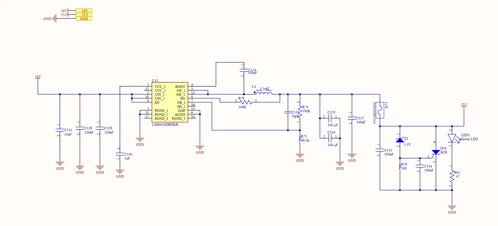

**3.3 V rail**
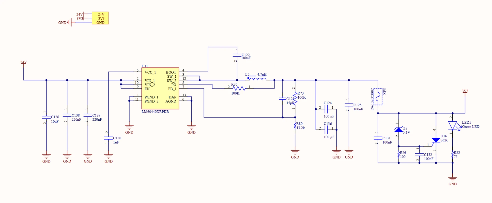

## PCB Layout

6-layer, 2 oz outer / 1 oz inner copper, about 62 mil total, with 100 Ω differential pairs for the Ethernet side ([stackup](images/stackup.png)). The heavy outer copper follows TI's thermal recommendation (§11.1.1).

| 2.5 V | 3.3 V |
|---|---|
| 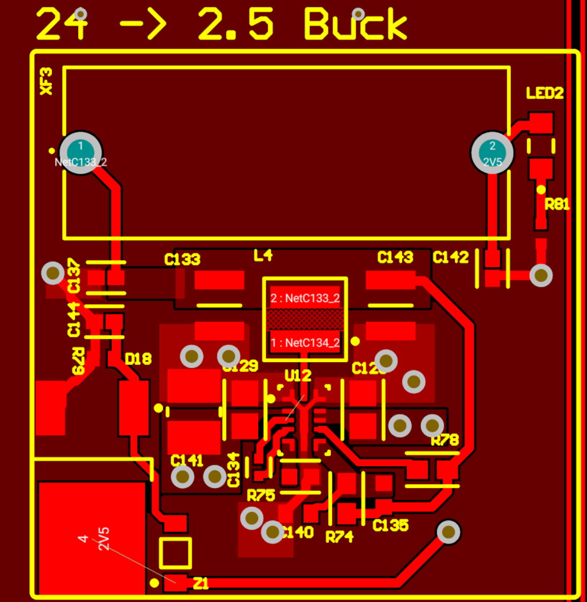 | 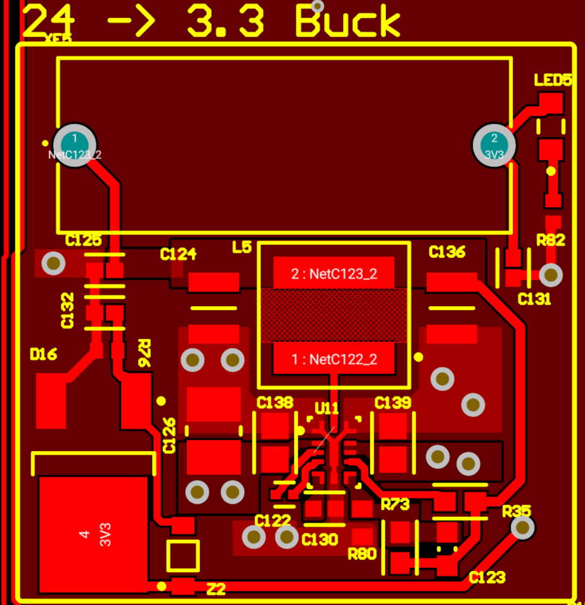 |

<details>
<summary>More layer views</summary>

| 2.5 V | 3.3 V |
|---|---|
| 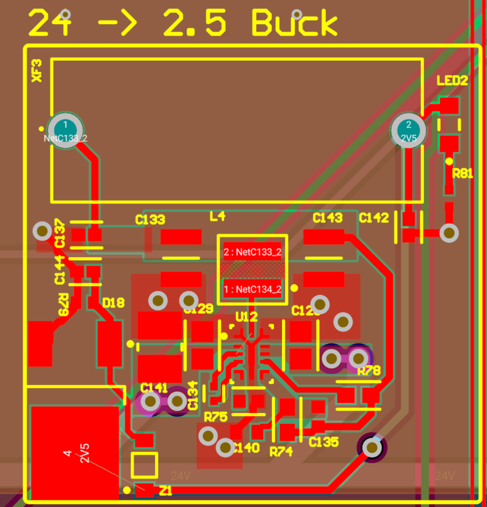 | 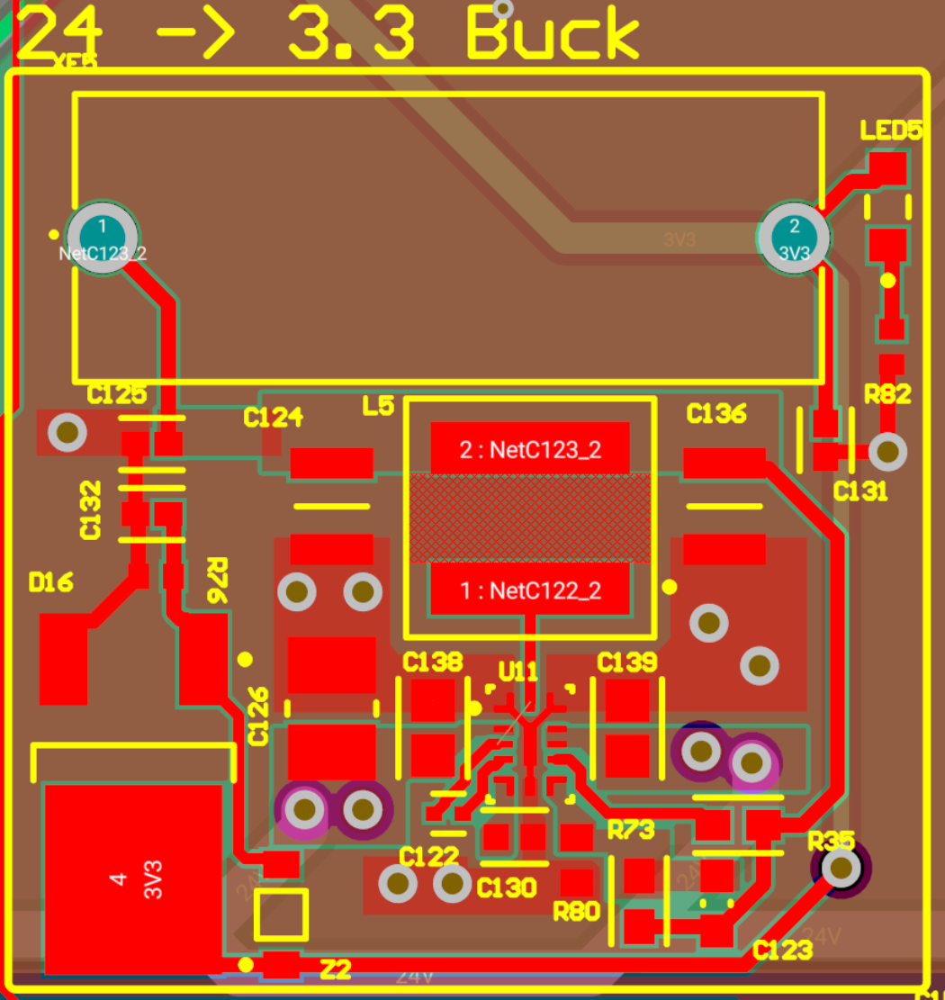 |
| 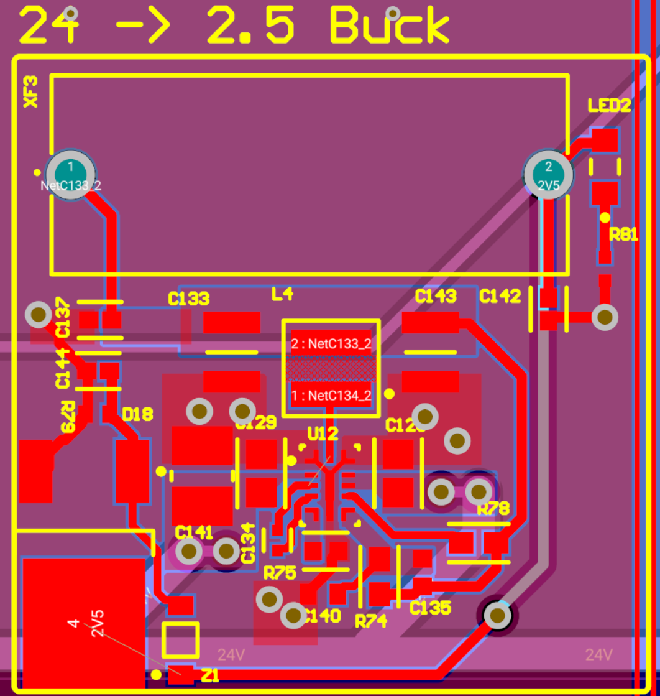 | 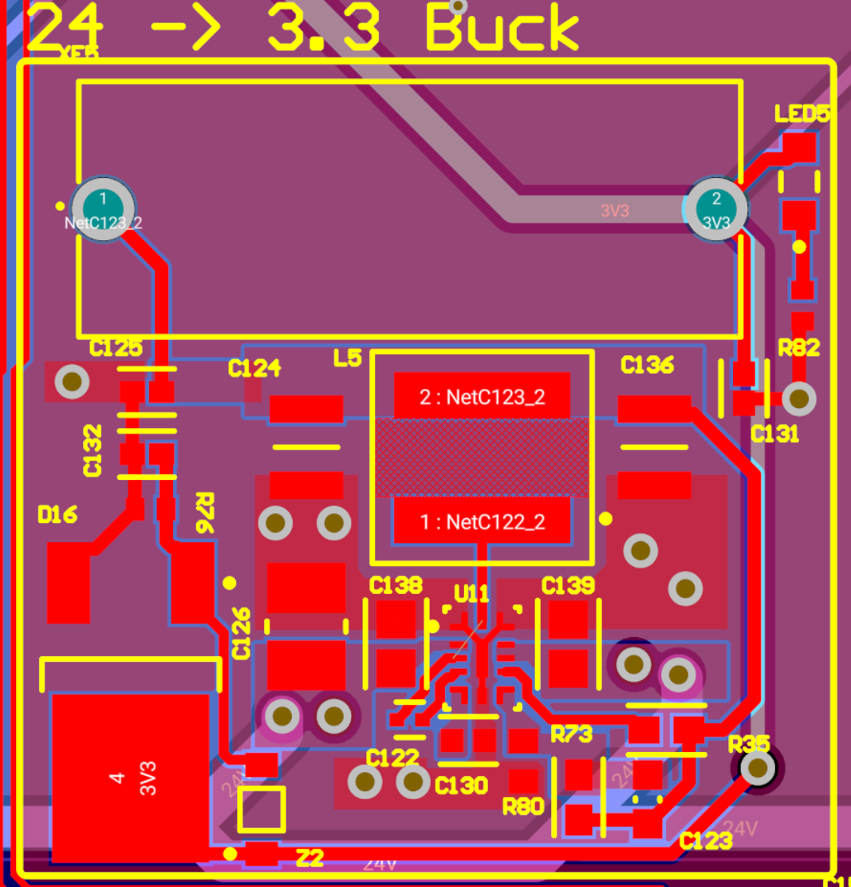 |

</details>

Layout choices, mapped to the TI layout guidelines (§11.1):

- **Hot loop (guideline 1).** The 220 nF HF capacitors (C128/C129, C138/C139) sit on *both* sides of the IC at the two VIN/PGND pin pairs. The symmetric input loops partially cancel each other's magnetic fields and reduce EMI.
- **Bootstrap and VCC (guidelines 2–3).** CBOOT (C134/C122) and CVCC (C140/C130) are placed directly at their pins with short traces.
- **Feedback (guideline 4).** The divider and CFF sit next to the FB pin. The VOUT sense trace is routed away from the switch node.
- **Switch node (guideline 8).** The inductor sits directly over the SW pins to keep the high-dv/dt copper area small.
- **Thermal (guidelines 5, 7).** A solid inner ground plane plus stitching vias spread heat away from the exposed pad. The estimated IC loss is ≈ 1.1 W (2.5 V) and ≈ 1.5 W (3.3 V) at an assumed 85 % efficiency. Keeping $`T_J \le 150`$ °C at 85 °C ambient requires an effective $`R_{\theta JA}`$ below ≈ 59 and 43 °C/W respectively (Eq. 10); bring-up will verify this with a thermal camera.

## Design Review & Rev 2

Findings from reviewing my own Rev 1 design against the datasheets:

| # | Finding | Impact | Rev 2 action |
|---|---|---|---|
| 1 | The 3.3 V crowbar trips at 5.4–6.7 V, but the TPS23861 VDD abs max is 4.0 V. | Overvoltage could damage loads before the crowbar fires. | Replace the Zener trigger with a **TL431 shunt-reference trigger** set to 3.8 V ($`R_{top}/R_{bot} = 3.8/2.495 - 1 = 0.523`$, e.g. 52.3 kΩ / 100 kΩ). That is above the regulator's PG-OV point (3.53 V) and below 4 V. Precision ±1–2 % instead of ±15 %. |
| 2 | 2.5 V crowbar margin at hot. The MMSZ3V3 can conduct about 1–2 mA at the 2.57 V worst-case rail, which puts 0.1–0.2 V on the gate. The MCR706A only guarantees non-triggering below 0.2 V at 110 °C. | Possible nuisance trip at high temperature. | Use the same TL431 trigger (≈ 3.0 V trip), or validate across temperature during bring-up. |
| 3 | Fuse/SCR coordination: the 4 A fuse melts at 29 A²s, but the MCR706A is rated for only 2.6 A²s. | In a hard high-side short from a stiff 24 V source, the SCR may fail before the fuse opens (SCRs usually fail short, but that isn't guaranteed). | Use a higher-surge SCR with I²t > fuse clearing I²t, or reduce the fuse rating once the load budget is measured. |
| 4 | A single 10 µF 50 V X7R input cap loses a large share of its capacitance at 24 V DC bias. TI's ≥ 10 µF requirement is for *effective* capacitance. | Higher input ripple and EMI. | Add a second 10 µF per rail, plus 20–100 µF bulk if the 24 V bus arrives over a harness (§10). |
| 5 | The output capacitor MPN is not yet fixed (only the 1210 footprint is chosen). Eq. 5 needs ≥ 117 µF *effective* on the 2.5 V rail. | 2 × 100 µF may fall short after DC-bias derating. | Choose a ≥ 10 V X5R/X7R part using its bias curve, and add a third 100 µF if needed. |
| 6 | PG is only pulled up; EN is tied to VIN. | No fault reporting and no sequencing. | Route PG to the controller and add an EN divider UVLO (Eq. 9: 137 kΩ / 10 kΩ gives 18.1 V on and 16.6 V off). |

## Bring-up Plan

Full procedure with pass/fail criteria: [docs/bringup_test_plan.md](docs/bringup_test_plan.md). In summary: current-limited first power-up, regulation over line and load, ripple with a tip-and-barrel probe, 0→3 A load-step response, a loop Bode plot (injection resistor in series with $`R_{FBT}`$), switch-node ringing, a thermal soak at 3 A, and a deliberate crowbar trip test with a bench supply forced onto the rail.

## What I Learned

- Datasheet equations hide assumptions. "10 µF" means effective capacitance under DC bias, and the inductor ripple target depends on whether you size against the load or the device rating.
- A protection circuit is only as good as its worst-case trip window. A ±5 % Zener plus a 0.5–1.0 V SCR gate spread produces a window too wide for a 3.3 V rail feeding 4 V parts.
- Where a sense point sits matters as much as the part values. Feedback taken before the fuse keeps the loop closed when the fuse opens.
- Writing the analysis as a script made it easy to iterate as component values changed.

## Repository Contents

```
├── README.md                     ← this page
├── calc/buck_calcs.py            ← reproducible design calculations
├── docs/
│   ├── design_calculations.md    ← full derivations with datasheet citations
│   ├── bringup_test_plan.md      ← verification plan and pass criteria
│   └── archive/                  ← Rev 0 README and calculations (superseded)
├── hardware/
│   └── PN_Controller_Gerbers_WIP.zip
└── images/                       ← schematics, layout, 3D, stackup
```

## References

- TI, *LM604x0 3.8-V to 36-V, 3-A and 4-A Synchronous Step-Down Converter*, SNVSBN5A, Rev. A, June 2020.
- Würth Elektronik datasheets 74439324033 and 74439384047 (WE-XHMI).
- onsemi MMSZ2V4T1/D (Rev. 11) Zener series; MCR703A/D (Rev. 7) SCR series.
- Littelfuse 217 series 5×20 mm fast-acting fuse datasheet.
- TI TPS23861 datasheet SLUSBX9J; TI TPS7A83A datasheet SBVS304B.

## License

MIT, see [LICENSE](LICENSE).
